<div align="center">


# OneURL
### Modern URL Shortener & QR Code Engine with Samsung OneUI Design

<p align="center">
  <a href="https://github.com/smartworldarafath/OneUI_URL/releases/latest" title="Download APK"><picture><source media="(prefers-color-scheme: dark)" srcset="assets/readme/dark/btn-download.svg">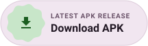</picture></a>
  <a href="https://github.com/smartworldarafath/OneUI_URL" title="Source Code"><picture><source media="(prefers-color-scheme: dark)" srcset="assets/readme/dark/btn-github.svg"></picture></a>
  <a href="#community" title="Support Project"><picture><source media="(prefers-color-scheme: dark)" srcset="assets/readme/dark/btn-sponsor.svg">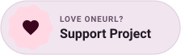</picture></a>
</p>

<p align="center">
  <a href="#overview" title="Android Native App"><picture><source media="(prefers-color-scheme: dark)" srcset="assets/readme/dark/badge-android.svg"></picture></a>
  <a href="#techstack" title="Kotlin 2.x"><picture><source media="(prefers-color-scheme: dark)" srcset="assets/readme/dark/badge-kotlin.svg"></picture></a>
  <a href="#oneui" title="Samsung OneUI Design System"><picture><source media="(prefers-color-scheme: dark)" srcset="assets/readme/dark/badge-oneui.svg"></picture></a>
  <a href="#safety" title="URLhaus Threat Intelligence API"><picture><source media="(prefers-color-scheme: dark)" srcset="assets/readme/dark/badge-urlhaus.svg"></picture></a>
  <a href="#overview" title="100% Client-Side Safe"><picture><source media="(prefers-color-scheme: dark)" srcset="assets/readme/dark/badge-clientonly.svg"></picture></a>
  <a href="#overview" title="Zero Backend Server Requirement"><picture><source media="(prefers-color-scheme: dark)" srcset="assets/readme/dark/badge-zerobackend.svg"></picture></a>
  <a href="LICENSE" title="Apache 2.0 Open Source License"><picture><source media="(prefers-color-scheme: dark)" srcset="assets/readme/dark/badge-apache.svg"></picture></a>
  <a href="https://github.com/smartworldarafath/OneUI_URL/pulls" title="Pull Requests Welcome"><picture><source media="(prefers-color-scheme: dark)" srcset="assets/readme/dark/badge-prs.svg"></picture></a>
</p>

<br/>

<p align="center">
  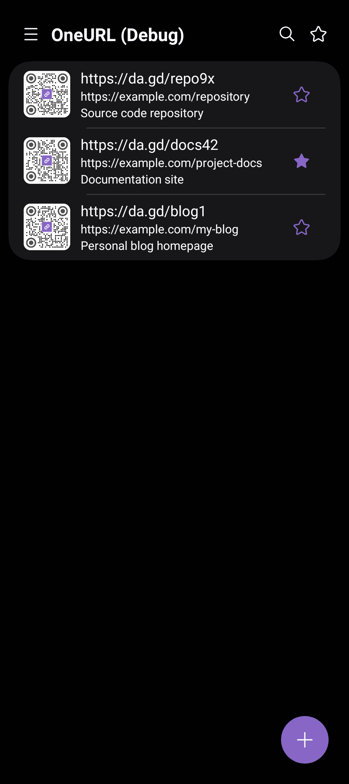
  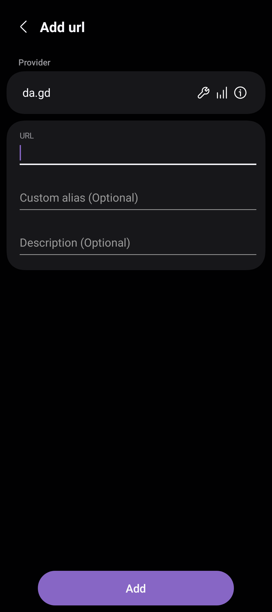
  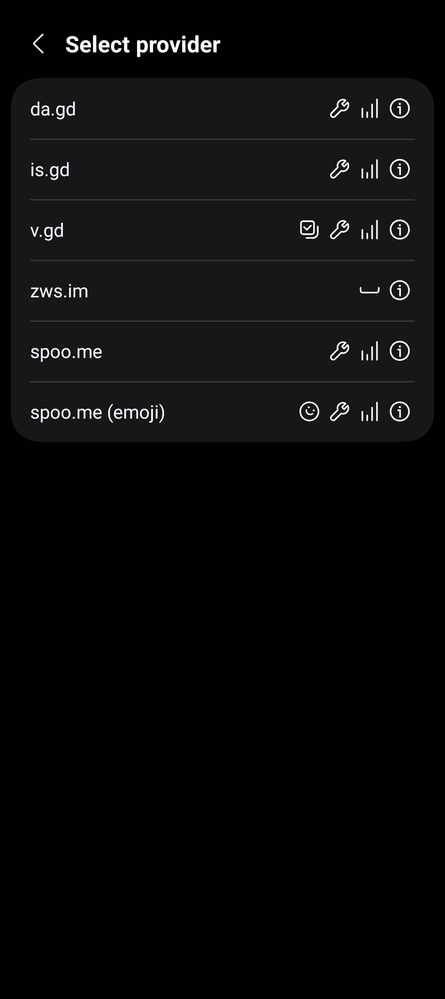
  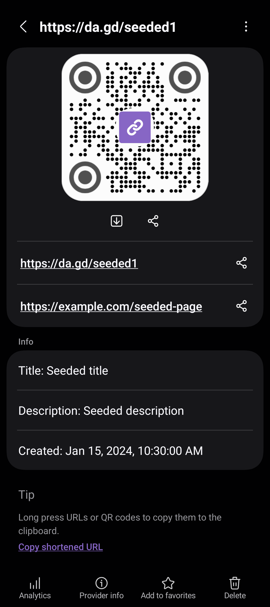
  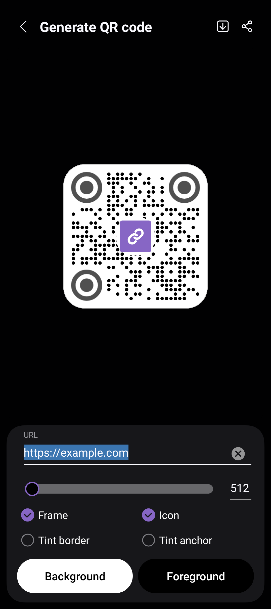
  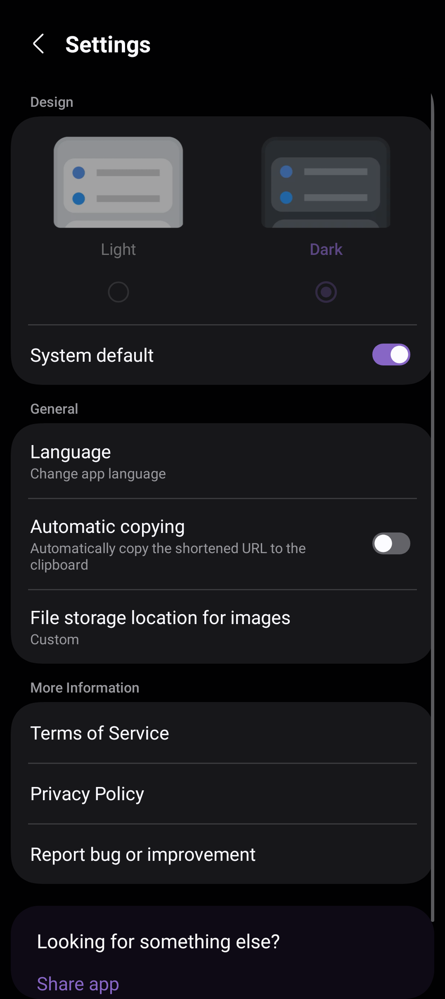
</p>

</div>

---

<h3 id="overview"><picture><source media="(prefers-color-scheme: dark) and (max-width: 640px)" srcset="assets/readme/dark/hm-overview.svg"><source media="(prefers-color-scheme: dark)" srcset="assets/readme/dark/h-overview.svg"><source media="(max-width: 640px)" srcset="assets/readme/light/hm-overview.svg">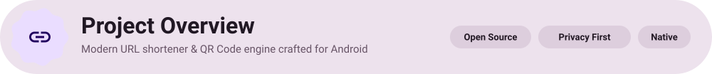</picture></h3>

**OneURL** is an open-source Android application designed to shorten long URLs across more than 20 reputable URL-shortening services while instantly synthesizing customizable, vector-sharp QR codes for any link. Built strictly adhering to Samsung's **OneUI Design Guidelines** and enhanced with Google Pixel **Material 3 Expressive** aesthetic harmony, it delivers an intuitive, tactile, and one-handed friendly user experience on modern Android devices.

---

<h3 id="features"><picture><source media="(prefers-color-scheme: dark) and (max-width: 640px)" srcset="assets/readme/dark/hm-features.svg"><source media="(prefers-color-scheme: dark)" srcset="assets/readme/dark/h-features.svg"><source media="(max-width: 640px)" srcset="assets/readme/light/hm-features.svg"></picture></h3>

<div align="center">

<table width="100%">
  <tr>
    <td width="50%" align="center" valign="top">
      <picture><source media="(prefers-color-scheme: dark)" srcset="assets/readme/dark/card-providers.svg">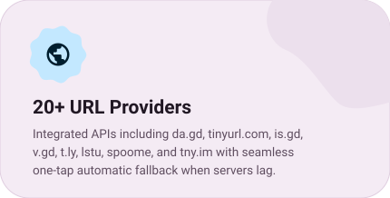</picture>
    </td>
    <td width="50%" align="center" valign="top">
      <picture><source media="(prefers-color-scheme: dark)" srcset="assets/readme/dark/card-alias.svg">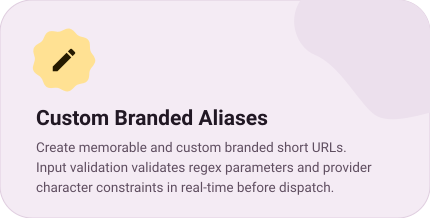</picture>
    </td>
  </tr>
  <tr>
    <td width="50%" align="center" valign="top">
      <picture><source media="(prefers-color-scheme: dark)" srcset="assets/readme/dark/card-safety.svg"></picture>
    </td>
    <td width="50%" align="center" valign="top">
      <picture><source media="(prefers-color-scheme: dark)" srcset="assets/readme/dark/card-oneui.svg">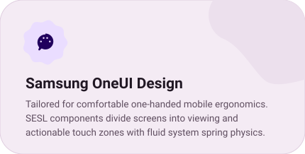</picture>
    </td>
  </tr>
  <tr>
    <td width="50%" align="center" valign="top">
      <picture><source media="(prefers-color-scheme: dark)" srcset="assets/readme/dark/card-qrcode.svg">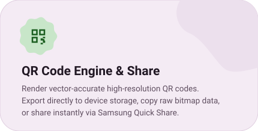</picture>
    </td>
    <td width="50%" align="center" valign="top">
      <picture><source media="(prefers-color-scheme: dark)" srcset="assets/readme/dark/card-autocopy.svg">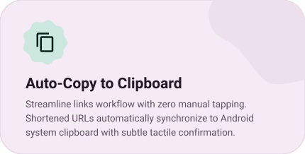</picture>
    </td>
  </tr>
  <tr>
    <td width="50%" align="center" valign="top">
      <picture><source media="(prefers-color-scheme: dark)" srcset="assets/readme/dark/card-history.svg">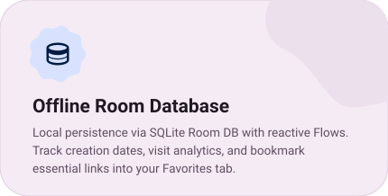</picture>
    </td>
    <td width="50%" align="center" valign="top">
      <picture><source media="(prefers-color-scheme: dark)" srcset="assets/readme/dark/card-speed.svg">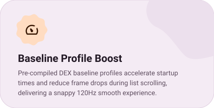</picture>
    </td>
  </tr>
</table>

</div>

### Detailed Functionality & Architecture Breakdown

#### 1. 🔗 Multiple URL Shortener Providers
* **Description**: Users can choose from over 20 reliable URL-shortening engines rather than relying on a single third-party service.
* **How It Works**: When a user selects a provider and triggers shortening, the app dispatches an asynchronous network request through Volley (`RequestQueueSingleton`). Each service is decoupled as an independent object implementing `ShortURLProvider`. If an endpoint is rate-limited or unavailable, users can immediately toggle to another provider with instant fallback.

```text
ShortURLProvider_System/
├── ShortURLProvider.kt                 <-- Base ShortURLProvider interface & contract
├── ShortURLProviderCompanion.kt        <-- Registry of all active, grouped & disabled services
├── Dagd.kt                             <-- da.gd provider implementation
├── Tinyurl.kt                          <-- tinyurl.com provider implementation
├── VgdIsgd.kt                          <-- is.gd & v.gd provider implementation
├── Tly.kt                              <-- t.ly and sub-domain provider engine
├── Kurzelinks.kt                       <-- ogy.de, t1p.de, ocn.de, kurzelinks.de engines
└── Spoome.kt                           <-- Standard and Emoji URL shortener engines
```

#### 2. ✏️ Custom Alias Support
* **Description**: Create personalized, branded, and easy-to-remember short links instead of arbitrary random characters.
* **How It Works**: Providers supporting customized slugs declare an `AliasConfig` specifying allowed character sets and character length limits. The client checks input validity in real time prior to API transmission, preventing invalid network roundtrips and ensuring deterministic error handling.

```text
Custom_Alias_Engine/
├── AliasConfig.kt                      <-- Min/Max length thresholds and regex patterns
├── AddURLViewModel.kt                  <-- Real-time validation & user feedback StateFlow
└── AddURLActivity.kt                   <-- Input textfield & error banner interface
```

#### 3. 🛡️ URL Safety & Malware Verification
* **Description**: Proactively scans target destinations for malware, phishing, and spam before executing the shortening process.
* **How It Works**: `GenerateURLUseCase` queries the **URLhaus** Threat Intelligence API (`CheckURLSafetyUseCase`) using the destination URL. If identified on spam or malicious blacklists (Spamhaus, SURBL, URLhaus), the operation is halted, displaying detailed diagnostic findings and VirusTotal links directly to the user.

```text
Safety_Verification_Engine/
├── CheckURLSafetyUseCase.kt            <-- URLhaus API client & threat assessment
├── GenerateURLUseCase.kt               <-- Intercepting safety pipeline before provider call
└── AddURLErrorDialogs.kt               <-- Security alert dialogs with VirusTotal links
```

#### 4. 📱 Samsung OneUI Design System
* **Description**: Engineered specifically for fluid, comfortable one-handed navigation on large smartphone displays.
* **How It Works**: Implemented using the official Samsung SESL (Samsung Experience Support Library) wrappers (`io.github.tribalfs:oneui-design`). The interface divides into an upper viewing Header zone and lower interaction Actionable zone, complete with native spring animations, ripple touch feedback, and automated light/dark mode adaptation.

```text
OneUI_Design_System/
├── res/layout/activity_main.xml        <-- OneUI Appbar & collapsible toolbar structure
├── res/values/styles.xml               <-- Theme.OneUI primary and secondary accents
├── res/values-night/styles.xml         <-- Amoled dark mode color definitions
└── SESL_Components/                    <-- SeslRecyclerView, SeslSwitchPreference & SeslButtons
```

#### 5. 📷 QR Code Generation & Sharing
* **Description**: Instantly renders sharp, customizable QR codes for any created short link or arbitrary input string.
* **How It Works**: The `GenerateQRCodeUseCase` generates vector-accurate Bitmaps using `QrEncoder`. The `QRCodeExportStateHolder` coordinates background execution via coroutines—allowing one-tap export to storage via Android's Storage Access Framework, system clipboard copy, or dispatch to nearby devices via Samsung Quick Share and Android ShareSheet.

```text
QRCode_Engine/
├── GenerateQRCodeUseCase.kt            <-- High-resolution bitmap renderer with custom styling
├── QRCodeCache.kt                      <-- In-memory LRU cache preventing duplicate renders
├── QRCodeExporter.kt                   <-- MediaStore & Storage Access Framework exporter
├── QRCodeExport.kt                     <-- StateHolder managing Save, Copy & Share states
└── QRBottomSheet.kt                    <-- Fluid OneUI modal sheet with full export actions
```

#### 6. 📋 Instant Clipboard & Auto-Copy
* **Description**: Eliminates repetitive steps by immediately copying successfully shortened URLs straight to the device clipboard.
* **How It Works**: Governed by the `auto_copy_on_create` preference stored in `UserSettings`. Once `GenerateURLUseCase` signals success, `AddURLViewModel` interacts with Android's `ClipboardManager`, accompanied by an audible/haptic feedback toast notification.

```text
AutoCopy_Service/
├── UserSettings.kt                     <-- DataStore / SharedPreferences toggle flag
├── SettingsActivity.kt                 <-- OneUI toggle preference UI
└── AddURLViewModel.kt                  <-- Automated clipboard dispatch on Success state
```

#### 7. 💾 Local History & Favorites Bookmarks
* **Description**: Completely offline archive ensuring all your past shortened links and stats remain instantly accessible.
* **How It Works**: An in-app **Room SQLite Database** stores URL entities (`URLDb`), mapping them to clean domain models via `DomainMapper`. Built-in reactive Kotlin `Flow` streams deliver real-time database updates to the UI, enabling instant search, visit counting, and fast toggle of favorite bookmarks.

```text
Persistence_Archive/
├── AppDatabase.kt                      <-- Room Database configuration & schema migrations
├── URLDao.kt                           <-- Reactive CRUD queries (Insert, Delete, Observe)
├── DomainMapper.kt                     <-- Clean Architecture converter (URLDb <-> URL)
├── URLRepository.kt                    <-- Single Source of Truth wrapping Room calls
└── MainViewModel.kt                    <-- Emits filtered Flow<List<URL>> (All / Favorites)
```

---

<h3 id="structure"><picture><source media="(prefers-color-scheme: dark) and (max-width: 640px)" srcset="assets/readme/dark/hm-structure.svg"><source media="(prefers-color-scheme: dark)" srcset="assets/readme/dark/h-structure.svg"><source media="(max-width: 640px)" srcset="assets/readme/light/hm-structure.svg"></picture></h3>

```text
OneUI_URL/
├── app/                                 <-- Main Android Application Module
│   ├── src/
│   │   ├── main/
│   │   │   ├── java/de/lemke/oneurl/
│   │   │   │   ├── data/                <-- Data Layer: Room DB, DAO, Preferences & QR Exporters
│   │   │   │   │   ├── database/        <-- AppDatabase, URLDao, Entities & Converters
│   │   │   │   │   ├── QRCodeCache.kt   <-- In-Memory & Disk QR Code Caching Engine
│   │   │   │   │   ├── QRCodeExporter.kt<-- Storage Access Framework & Share Exporter
│   │   │   │   │   ├── URLRepository.kt <-- Room Repository managing URL Persistence
│   │   │   │   │   └── UserSettings.kt  <-- User Settings & SharedPreferences wrapper
│   │   │   │   ├── di/                  <-- Dependency Injection (Hilt Modules)
│   │   │   │   │   ├── DispatchersModule.kt <-- Coroutine Dispatchers (@Default, @Io)
│   │   │   │   │   ├── PersistenceModule.kt <-- Room DB & DAO bindings
│   │   │   │   │   ├── ProviderModule.kt    <-- ShortURLProvider injection bindings
│   │   │   │   │   └── SettingsModule.kt    <-- App Settings provider injection
│   │   │   │   ├── domain/              <-- Domain Layer: Business Logic & Use Cases
│   │   │   │   │   ├── generateURL/     <-- URL Generation, Safety & Volley Request Engine
│   │   │   │   │   │   ├── GenerateURLUseCase.kt <-- Core URL Shortening Pipeline
│   │   │   │   │   │   └── RequestQueueSingleton.kt <-- Volley Networking Queue
│   │   │   │   │   ├── model/           <-- 20+ URL Provider Implementations (TinyURL, da.gd, etc.)
│   │   │   │   │   ├── CheckURLSafetyUseCase.kt <-- URLhaus Threat Intelligence Scanner
│   │   │   │   │   ├── GenerateQRCodeUseCase.kt <-- High-res QR Code Generator
│   │   │   │   │   └── URLUseCases.kt   <-- Add, Delete, Observe, Update & Get URLs
│   │   │   │   └── ui/                  <-- Presentation Layer: Activities, Adapters & ViewModels
│   │   │   │       ├── MainActivity.kt  <-- Core Hub displaying Saved URLs & Favorites
│   │   │   │       ├── AddURLActivity.kt<-- URL Creation & Provider Selection Interface
│   │   │   │       ├── URLActivity.kt   <-- Detailed URL Inspection & Analytics View
│   │   │   │       ├── GenerateQRCodeActivity.kt <-- Standalone QR Code Generation Tool
│   │   │   │       ├── SettingsActivity.kt       <-- App Preferences & Configuration Screen
│   │   │   │       └── QRCodeExport.kt  <-- Quick Share, Clipboard & Export Handlers
│   │   │   └── res/                     <-- Android Resources: Layouts, Drawables, Strings, OneUI Themes
│   │   └── test/                        <-- Architecture, Unit & Roborazzi Screenshot Tests
│   └── build.gradle.kts                 <-- App-level build config, dependencies & baseline profiles
│
├── benchmarks/                          <-- Android Macrobenchmark & Baseline Profile Generator
│   ├── src/main/java/.../benchmarks/    <-- Startup, Scroll & Metrics Automation Tests
│   └── build.gradle.kts                 <-- Benchmark runner & target app configurations
│
├── config/                              <-- Code Quality & Analysis Rules
│   ├── detekt/detekt.yml                <-- Detekt Static Code Analysis ruleset
│   └── spotless/                        <-- License Header & ktlint formatting specs
│
├── gradle/                              <-- Gradle Wrapper & Version Catalogs
│   ├── libs.versions.toml               <-- Centralized dependency & plugin version catalog
│   └── wrapper/                         <-- Gradle wrapper binary and configuration
│
├── img/                                 <-- Project Media Assets
│   └── OneURL_squircle.png              <-- High-Resolution App Icon
│
├── scripts/                             <-- Utility & Asset Generator Scripts
│   └── generate-pixel-assets.js         <-- Material 3 Expressive Animated SVG Generator
│
├── build.gradle.kts                     <-- Top-level Gradle root project build configuration
├── settings.gradle.kts                  <-- Gradle project settings & repository resolution
├── CLAUDE.md                            <-- Architecture, commands & build reference guide
├── LICENSE                              <-- Apache 2.0 Open-Source License
└── README.md                            <-- Comprehensive Master Documentation
```

---

<h3 id="techstack"><picture><source media="(prefers-color-scheme: dark) and (max-width: 640px)" srcset="assets/readme/dark/hm-techstack.svg"><source media="(prefers-color-scheme: dark)" srcset="assets/readme/dark/h-techstack.svg"><source media="(max-width: 640px)" srcset="assets/readme/light/hm-techstack.svg">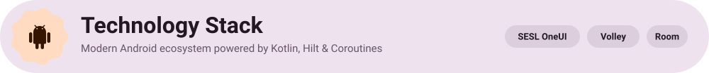</picture></h3>

<div align="center">

<p align="center">
  <picture><source media="(prefers-color-scheme: dark)" srcset="assets/readme/dark/pill-kotlin.svg"></picture>
  <picture><source media="(prefers-color-scheme: dark)" srcset="assets/readme/dark/pill-cleanarch.svg"></picture>
  <picture><source media="(prefers-color-scheme: dark)" srcset="assets/readme/dark/pill-hilt.svg"></picture>
  <picture><source media="(prefers-color-scheme: dark)" srcset="assets/readme/dark/pill-sesl.svg"></picture>
  <picture><source media="(prefers-color-scheme: dark)" srcset="assets/readme/dark/pill-room.svg"></picture>
  <picture><source media="(prefers-color-scheme: dark)" srcset="assets/readme/dark/pill-coroutines.svg"></picture>
  <picture><source media="(prefers-color-scheme: dark)" srcset="assets/readme/dark/pill-volley.svg"></picture>
  <picture><source media="(prefers-color-scheme: dark)" srcset="assets/readme/dark/pill-roborazzi.svg"></picture>
  <picture><source media="(prefers-color-scheme: dark)" srcset="assets/readme/dark/pill-urlhaus.svg"></picture>
</p>

<br/>

<p align="center">
  
  
  
  
  
  
</p>

</div>

---

<h3 id="screenshots"><picture><source media="(prefers-color-scheme: dark) and (max-width: 640px)" srcset="assets/readme/dark/hm-screenshots.svg"><source media="(prefers-color-scheme: dark)" srcset="assets/readme/dark/h-screenshots.svg"><source media="(max-width: 640px)" srcset="assets/readme/light/hm-screenshots.svg">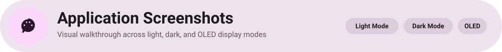</picture></h3>

<div align="center">

<p align="center">
  
  
  
  
  
  
</p>

<br/>

<p align="center">
  
  
  
  
  
  
</p>

</div>

---

<h3 id="install"><picture><source media="(prefers-color-scheme: dark) and (max-width: 640px)" srcset="assets/readme/dark/hm-install.svg"><source media="(prefers-color-scheme: dark)" srcset="assets/readme/dark/h-install.svg"><source media="(max-width: 640px)" srcset="assets/readme/light/hm-install.svg"></picture></h3>

Download the latest verified release APK directly from GitHub:
👉 **[Releases Archive](https://github.com/smartworldarafath/OneUI_URL/releases)**

1. Grab `app-release.apk` from the latest release tag.
2. Open the APK on your Android device (Android 8.0 Oreo through Android 15+ supported).
3. Confirm installation and launch **OneURL**.

---

<h3 id="community"><picture><source media="(prefers-color-scheme: dark) and (max-width: 640px)" srcset="assets/readme/dark/hm-community.svg"><source media="(prefers-color-scheme: dark)" srcset="assets/readme/dark/h-community.svg"><source media="(max-width: 640px)" srcset="assets/readme/light/hm-community.svg">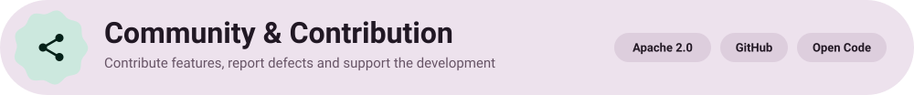</picture></h3>

<div align="center">

<a href="https://github.com/smartworldarafath/OneUI_URL/issues"><picture><source media="(prefers-color-scheme: dark)" srcset="assets/readme/dark/btn-issues.svg">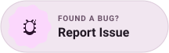</picture></a>
<a href="https://github.com/smartworldarafath/OneUI_URL/pulls"><picture><source media="(prefers-color-scheme: dark)" srcset="assets/readme/dark/btn-contribute.svg">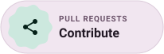</picture></a>
<a href="LICENSE"><picture><source media="(prefers-color-scheme: dark)" srcset="assets/readme/dark/btn-license.svg">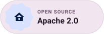</picture></a>

</div>

<br>

<div align="center">

| Action | Resource |
|:---|:---|
| **Latest Releases** | [smartworldarafath/OneUI_URL/releases](https://github.com/smartworldarafath/OneUI_URL/releases) |
| **Bug Tracker** | [GitHub Issues](https://github.com/smartworldarafath/OneUI_URL/issues) |
| **Pull Requests** | [GitHub Pull Requests](https://github.com/smartworldarafath/OneUI_URL/pulls) |
| **License** | [Apache License 2.0](LICENSE) |

</div>

---

## 📄 License

This project is licensed under the **Apache License 2.0**. See the [LICENSE](LICENSE) file for complete details.
